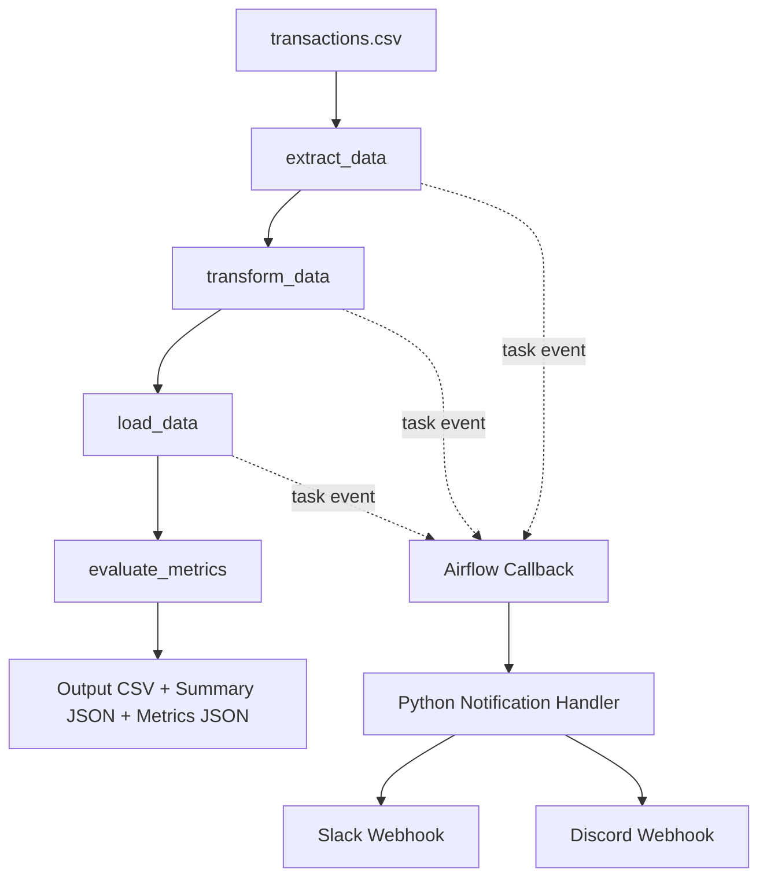

# MODUL PRAKTIKUM
# Pipeline Monitoring & Alerting dengan Apache Airflow, Python Webhook, Slack, dan Discord
## 1. Studi kasus: ETL transaksi penjualan

Sebuah perusahaan memiliki data transaksi penjualan yang dikirim dalam file CSV. Setiap hari data perlu dibaca, divalidasi, dihitung nilai penjualannya, dan disimpan sebagai hasil olahan.

Tim data engineering perlu mengetahui:

- Apakah seluruh tahap ETL berhasil?
- Task mana yang gagal?
- Berapa lama pipeline berjalan?
- Apakah data tersedia tepat waktu?
- Seberapa sering pipeline gagal?
- Bagaimana tim mengetahui kegagalan tanpa menunggu laporan pengguna?

### 1.1 Alur pipeline



### 1.2 Data yang digunakan

File `data/input/transactions.csv` berisi 12 transaksi sintetis dengan kolom:

| Kolom | Keterangan |
|---|---|
| transaction_id | ID transaksi |
| customer_id | ID pelanggan sintetis |
| product | Nama produk |
| quantity | Jumlah unit |
| unit_price | Harga per unit dalam IDR |
| event_time | Waktu kejadian transaksi |
| expected_available_at | Waktu data diharapkan tersedia |
| actual_available_at | Waktu data benar-benar tersedia |

Data tidak berisi informasi pelanggan nyata. Nilai waktu sengaja dibuat bervariasi agar mahasiswa dapat menghitung latency.

File `data/input/run_history.csv` berisi lima run historis untuk latihan menghitung failure rate, rata-rata duration, dan latency.

### 1.3 Output yang dihasilkan

Setelah pipeline berhasil:

- `data/output/transactions_clean.csv` — hasil transformasi transaksi dengan kolom revenue.
- `data/output/sales_summary.json` — jumlah record dan total revenue.
- `data/metrics/latest_metrics.json` — duration, latency, threshold, dan status alert.

## 2. Arsitektur dan komponen sistem

| Komponen | Fungsi |
|---|---|
| Docker Engine | Menjalankan container |
| Docker Compose | Mengelola layanan multi-container |
| Apache Airflow Webserver | Antarmuka pengelolaan DAG |
| Airflow Scheduler | Menjadwalkan dan memicu task |
| PostgreSQL | Menyimpan metadata Airflow |
| Python | Implementasi ETL, metrik, dan callback |
| Requests | Mengirim HTTP POST |
| Slack/Discord | Kanal notifikasi opsional |

## 3. Struktur folder proyek

Setelah paket diekstrak, struktur direktori:

```text
pipeline_monitoring_practicum/
├── dags/
│   ├── etl_monitoring_demo.py
│   └── notification_utils.py
├── data/
│   ├── input/
│   │   ├── transactions.csv
│   │   └── run_history.csv
│   ├── output/
│   └── metrics/
├── scripts/
│   └── analyze_run_history.py
├── logs/
├── plugins/
├── config/
├── Dockerfile
├── docker-compose.yaml
├── requirements.txt
├── .env.example
├── .gitignore
└── README.md
```

Folder `logs`, `plugins`, `config`, `data/output`, dan `data/metrics` disediakan untuk kebutuhan runtime.

## 4. Persiapan dan instalasi tools

### 4.1 Instalasi Docker Desktop

**macOS:**

1. Buka halaman resmi Docker Desktop: https://www.docker.com/products/docker-desktop/
2. Unduh installer sesuai arsitektur perangkat:
   - Apple Silicon: pilih versi Apple Silicon.
   - Intel: pilih versi Intel.
3. Buka file installer dan pindahkan Docker ke Applications jika diminta.
4. Jalankan Docker Desktop.
5. Tunggu sampai status Docker Engine aktif.

**Windows:**

1. Unduh Docker Desktop dari https://www.docker.com/products/docker-desktop/.
2. Ikuti installer dan gunakan backend WSL 2 jika tersedia/diperlukan.
3. Restart jika installer memintanya.
4. Jalankan Docker Desktop dan tunggu sampai engine aktif.

**Linux:**

Ikuti dokumentasi resmi Docker Engine dan Compose sesuai distribusi: https://docs.docker.com/engine/install/

### 4.2 Verifikasi Docker

Jalankan:

```bash
docker --version
docker compose version
docker info
```

Contoh pemeriksaan sederhana:

```bash
docker run --rm hello-world
```

Hasil yang diharapkan: container `hello-world` dapat berjalan dan menampilkan pesan bahwa Docker berhasil digunakan.

Jika `docker info` gagal, pastikan Docker Desktop/Engine sudah berjalan.

### 4.3 Memeriksa resource Docker

Airflow terdiri dari beberapa proses. Di Docker Desktop, buka Settings/Resources dan pastikan alokasi memori cukup. Jika container restart terus-menerus, periksa resource sebelum mengubah kode.

## 5. Menyiapkan project

1. Ekstrak paket `pipeline_monitoring_practicum.zip`.
2. Buka terminal.
3. Masuk ke direktori project:

```bash
cd pipeline_monitoring_practicum
```

4. Periksa file:

```bash
ls
```

Di Windows PowerShell gunakan:

```powershell
Get-ChildItem
```

5. Salin file konfigurasi contoh:

macOS/Linux:

```bash
cp .env.example .env
```

Windows PowerShell:

```powershell
Copy-Item .env.example .env
```

6. Untuk latihan awal, biarkan URL Slack dan Discord kosong. Airflow tetap dapat berjalan; notifikasi eksternal hanya dilewati.

Isi `.env` awal:

```dotenv
AIRFLOW_UID=50000
SLACK_WEBHOOK_URL=
DISCORD_WEBHOOK_URL=
```

## 6. Build dan instalasi Apache Airflow

Project memakai image `apache/airflow:2.10.5-python3.11` dan menambahkan library `requests`.

### 6.1 Build image

Dari direktori project:

```bash
docker compose build
```

Tunggu sampai image berhasil dibuat. Proses pertama membutuhkan waktu karena Docker mengunduh image dasar dan memasang dependensi.

### 6.2 Inisialisasi database Airflow

```bash
docker compose up airflow-init
```

Tunggu sampai proses inisialisasi selesai dengan exit code 0.

Service ini menjalankan migrasi metadata database dan membuat akun admin praktikum.

### 6.3 Jalankan Airflow

```bash
docker compose up -d
```

Periksa container:

```bash
docker compose ps
```

Periksa log bila diperlukan:

```bash
docker compose logs --tail=100 airflow-webserver
docker compose logs --tail=100 airflow-scheduler
```

### 6.4 Membuka Airflow UI

Buka browser:

http://localhost:8080

Login praktikum:

| Field | Nilai |
|---|---|
| Username | `airflow` |
| Password | `airflow` |

Kredensial ini hanya untuk lingkungan lokal latihan. Ganti sebelum penggunaan yang lebih luas.

### 6.5 Verifikasi DAG

1. Buka halaman DAGs.
2. Cari DAG bernama `etl_monitoring_demo`.
3. Pastikan DAG terlihat.
4. Jika belum terlihat, tunggu beberapa saat lalu refresh.
5. Periksa log scheduler:

```bash
docker compose logs --tail=100 airflow-scheduler
```

Jika muncul import error, periksa file di folder `dags/`.

## 7. Memahami DAG dan source code

### 7.1 File DAG

File utama: `dags/etl_monitoring_demo.py`.

DAG mempunyai empat task:

| Task | Fungsi |
|---|---|
| `extract_data` | Membaca CSV dan menyimpan waktu mulai pipeline |
| `transform_data` | Validasi dan menghitung revenue |
| `load_data` | Menyimpan ringkasan hasil ETL |
| `evaluate_metrics` | Menghitung duration dan latency serta mengevaluasi threshold |

Dependency:

```text
extract_data
     |
transform_data
     |
  load_data
     |
evaluate_metrics
```

### 7.2 File callback dan notification handler

File: `dags/notification_utils.py`.

Fungsi utama:

- `task_failure_callback(context)` — mengirim alert ketika task final gagal.
- `task_retry_callback(context)` — mengirim peringatan ketika task masuk proses retry.
- `dag_failure_callback(context)` — mencatat event kegagalan DAG.
- `send_alert(message, severity)` — membentuk payload dan mengirim ke kanal yang dikonfigurasi.

Kegagalan pengiriman notifikasi dicatat tanpa mencetak URL rahasia.

### 7.3 File Dockerfile dan requirements

`Dockerfile` menggunakan image Airflow 2.10.5 dengan Python 3.11, kemudian memasang `requests==2.32.3`.

`requirements.txt` berisi dependensi tambahan. Airflow tidak dipasang ulang secara terpisah agar versi Airflow tetap mengikuti image dasar.

## 8. Praktikum 1 — Menjalankan pipeline normal

**Tujuan:** memahami DAG, task dependency, status eksekusi, dan output ETL.

Langkah:

1. Login ke Airflow UI.
2. Cari `etl_monitoring_demo`.
3. Pastikan DAG dalam kondisi unpaused (tidak paused).
4. Klik tombol Trigger DAG.
5. Konfirmasi trigger jika diminta.
6. Buka Grid view atau Graph view.
7. Amati urutan task:
   - `extract_data`
   - `transform_data`
   - `load_data`
   - `evaluate_metrics`
8. Tunggu sampai seluruh task selesai.
9. Pastikan semua task berstatus success.

### 8.1 Memeriksa output

Dari terminal host:

```bash
ls data/output
cat data/output/sales_summary.json
cat data/metrics/latest_metrics.json
```

Di Windows PowerShell:

```powershell
Get-ChildItem data/output
Get-Content data/output/sales_summary.json
Get-Content data/metrics/latest_metrics.json
```

Periksa `transactions_clean.csv` dan pastikan terdapat kolom `revenue`.

**Pertanyaan mahasiswa:**

1. Berapa jumlah transaksi yang diproses?
2. Berapa total revenue?
3. Task mana yang pertama dijalankan?
4. Mengapa `evaluate_metrics` harus menunggu `load_data`?
5. Di mana mahasiswa dapat melihat log setiap task?

## 9. Praktikum 2 — Mengamati monitoring melalui Airflow UI

**Tujuan:** menghubungkan teori monitoring dengan tampilan eksekusi nyata.

### 9.1 Grid view

1. Buka DAG `etl_monitoring_demo`.
2. Pilih Grid.
3. Amati status setiap task.
4. Klik salah satu kotak task instance.
5. Buka detail dan log.

Hal yang diamati:

- Status task: success, failed, running, atau up_for_retry.
- Urutan task.
- Task yang membutuhkan waktu lebih lama.
- Jumlah percobaan task.

### 9.2 Graph view

1. Pilih Graph.
2. Amati hubungan antar-task.
3. Identifikasi upstream dan downstream.
4. Jelaskan apa yang terjadi jika `transform_data` gagal.

### 9.3 Task log

1. Klik task `transform_data`.
2. Buka tab Log.
3. Temukan pesan `Transformed ... rows` pada eksekusi sukses.
4. Bandingkan dengan log task yang gagal pada praktikum berikutnya.

Airflow UI dan task log merupakan sumber observasi utama pada latihan ini. Callback hanya salah satu mekanisme event; ia bukan dashboard historis lengkap.

## 10. Praktikum 3 — Menghitung execution duration

**Tujuan:** memahami lama waktu eksekusi pipeline.

DAG mencatat timestamp saat `extract_data` mulai. Task `evaluate_metrics` mengambil timestamp tersebut dan menghitung:

```python
duration_seconds = (end - start).total_seconds()
```

### Langkah pengamatan

1. Trigger DAG dengan kondisi normal.
2. Tunggu sampai selesai.
3. Buka file:

```bash
cat data/metrics/latest_metrics.json
```

4. Temukan field `execution_duration_seconds`.
5. Bandingkan dengan waktu pada Airflow UI.

### 10.1 Simulasi pipeline lambat

1. Di Airflow UI buka Admin → Variables.
2. Tambahkan variable:

| Key | Value |
|---|---|
| `simulate_slow_seconds` | `20` |

3. Simpan.
4. Trigger ulang DAG.
5. Task `load_data` akan menunggu 20 detik.
6. Buka log task `load_data`.
7. Amati durasi task dan total pipeline.

Threshold duration pada contoh adalah 900 detik (15 menit). Karena simulasi hanya 20 detik, kondisi ini belum memicu duration alert.

**Eksperimen lanjutan:** ubah threshold di kode menjadi 10 detik untuk demonstrasi warning, rebuild tidak diperlukan karena DAG di-mount dari host; tunggu scheduler memuat perubahan, lalu trigger ulang. Kembalikan threshold ke nilai awal setelah latihan.

Hapus variable `simulate_slow_seconds` atau ubah nilainya menjadi `0` setelah eksperimen.

## 11. Praktikum 4 — Menghitung pipeline latency

**Tujuan:** membedakan execution duration dan data latency.

Pada dataset, setiap record mempunyai:

- `expected_available_at`
- `actual_available_at`

Rumus:

```text
Latency = actual_available_at - expected_available_at
```

Contoh: data seharusnya tersedia pukul 08:00 dan aktual tersedia pukul 08:12. Latency = 12 menit.

### Langkah

1. Buka `data/input/transactions.csv`.
2. Pilih tiga baris transaksi.
3. Hitung selisih waktu expected dan actual.
4. Bandingkan hasil manual dengan field:
   - `average_data_latency_seconds`
   - `max_data_latency_seconds`
5. Periksa `latency_alert`.

Threshold latihan: 600 detik (10 menit). Data contoh memuat beberapa record dengan latency lebih dari 10 menit sehingga warning dapat muncul.

**Diskusi:** bagaimana mungkin pipeline hanya berjalan singkat, tetapi data tetap terlambat? Karena latency mengukur keterlambatan terhadap waktu yang diharapkan, bukan hanya lamanya task berjalan.

## 12. Praktikum 5 — Menghitung failure rate dari histori

**Tujuan:** menghitung proporsi eksekusi gagal.

File: `data/input/run_history.csv`.

Jalankan script dari root project:

```bash
python3 scripts/analyze_run_history.py
```

Di Windows:

```powershell
python scripts/analyze_run_history.py
```

Rumus:

```text
Failure Rate = (Failed Runs / Total Runs) × 100%
```

Data latihan mempunyai lima run dengan satu run gagal. Failure rate = 20%.

Script juga menghitung rata-rata duration untuk run sukses, rata-rata latency, dan latency maksimum.

### Tugas analisis

1. Ubah satu status `success` menjadi `failed` pada salinan file latihan.
2. Jalankan ulang script.
3. Amati perubahan failure rate.
4. Jelaskan mengapa definisi denominator harus konsisten.
5. Jawab apakah run yang masih running seharusnya dimasukkan ke denominator.


## 13. Praktikum 6 — Simulasi task failure dan callback

**Tujuan:** memahami hubungan status failed, callback, log, dan notifikasi.

### 13.1 Mengaktifkan simulasi kegagalan

1. Buka Airflow UI.
2. Pilih Admin → Variables.
3. Tambahkan variable:

| Key | Value |
|---|---|
| `simulate_failure` | `true` |

4. Simpan.
5. Trigger DAG `etl_monitoring_demo`.
6. Perhatikan task `extract_data` berhasil.
7. Perhatikan task `transform_data` gagal.
8. Karena default retry adalah 1, task akan mencoba kembali satu kali.
9. Setelah retry gagal, task berakhir failed.
10. Task downstream menjadi upstream_failed atau tidak berjalan sesuai dependency.

### 13.2 Memeriksa callback

1. Klik task `transform_data`.
2. Buka log.
3. Cari pesan error:

```text
SIMULATED FAILURE: transform task deliberately failed
```

4. Periksa log callback pada task log/scheduler sesuai versi dan konfigurasi Airflow.
5. Jika webhook sudah diatur, periksa pesan di Slack/Discord.
6. Catat DAG ID, task ID, run ID, severity, dan error.

### 13.3 Menguji retry

Perhatikan bahwa:

- `on_retry_callback` dipanggil ketika task masuk proses retry.
- `on_failure_callback` merespons kegagalan final task.
- Retry bukan callback; retry mengulang task, callback merespons event.

Setelah eksperimen, ubah `simulate_failure` menjadi `false` atau hapus variable tersebut agar pipeline dapat berhasil kembali.

## 14. Praktikum 7 — Menyiapkan Slack Incoming Webhook (opsional)

Langkah umum berikut memerlukan workspace Slack dan izin membuat/mengelola aplikasi atau webhook.

1. Buka dokumentasi Slack Incoming Webhooks: https://api.slack.com/messaging/webhooks
2. Ikuti instruksi membuat aplikasi atau memilih aplikasi yang diizinkan.
3. Aktifkan Incoming Webhooks.
4. Tambahkan webhook ke kanal latihan.
5. Salin URL webhook.
6. Perlakukan URL sebagai secret; jangan bagikan di screenshot atau source code.

Edit file `.env`:

```dotenv
AIRFLOW_UID=50000
SLACK_WEBHOOK_URL=https://hooks.slack.com/services/REDACTED/REDACTED/REDACTED
DISCORD_WEBHOOK_URL=
```

Ganti URL contoh dengan URL rahasia yang sebenarnya. Jangan gunakan teks `REDACTED` sebagai URL aktif.

Restart layanan agar environment variable diperbarui:

```bash
docker compose down
docker compose up -d
```

Uji dengan mengaktifkan `simulate_failure=true`, lalu trigger DAG.

Pesan di Slack seharusnya berisi severity, DAG ID, task ID, run ID, dan ringkasan error.

## 14. Praktikum 8 — Menyiapkan Discord Webhook (opsional)

1. Buka server Discord yang dikelola atau diizinkan untuk praktikum.
2. Pilih kanal latihan.
3. Buka pengaturan kanal/server → Integrations → Webhooks (nama menu dapat berubah).
4. Buat webhook.
5. Pilih kanal tujuan dan salin URL.
6. Simpan URL sebagai secret di `.env`.

Contoh:

```dotenv
AIRFLOW_UID=50000
SLACK_WEBHOOK_URL=
DISCORD_WEBHOOK_URL=https://discord.com/api/webhooks/REDACTED/REDACTED
```

Restart:

```bash
docker compose down
docker compose up -d
```

Trigger DAG dengan `simulate_failure=true` dan verifikasi pesan pada kanal Discord.

Payload Discord menggunakan `content`, sedangkan Slack Incoming Webhook menggunakan `text`. Keduanya ditangani oleh fungsi terpisah di `notification_utils.py`.

## 15. Praktikum 9 — Menguji webhook gagal

**Tujuan:** membuktikan bahwa pemanggilan callback tidak otomatis berarti notifikasi berhasil dikirim.

1. Simpan URL webhook yang valid secara terpisah.
2. Ubah URL sementara menjadi URL tidak valid di `.env`, misalnya:

```dotenv
SLACK_WEBHOOK_URL=https://example.invalid/webhook
```

3. Restart container:

```bash
docker compose down
docker compose up -d
```

4. Aktifkan `simulate_failure=true`.
5. Trigger DAG.
6. Periksa task log dan scheduler log.
7. Cari pesan `notification delivery failed`.
8. Pastikan URL rahasia tidak tercetak dalam log.
9. Kembalikan URL valid atau kosongkan konfigurasi setelah tes.

Kegagalan notifikasi harus dapat ditelusuri. Dalam sistem produksi, kegagalan delivery juga perlu dipantau melalui kanal alternatif atau mekanisme retry terkontrol.

## 16. Melihat dan mengumpulkan bukti monitoring

Mahasiswa wajib mengumpulkan:

| Bukti | Lokasi |
|---|---|
| DAG terdaftar | Airflow UI → DAGs |
| Alur dependency | Graph view |
| Status task | Grid view |
| Log sukses | Task instance → Log |
| Log gagal | Task instance → Log |
| Retry | Task instance / log attempt |
| Metrik duration dan latency | `data/metrics/latest_metrics.json` |
| Hasil ETL | `data/output/transactions_clean.csv` |
| Ringkasan transaksi | `data/output/sales_summary.json` |
| Failure rate | Terminal output `analyze_run_history.py` |
| Alert | Kanal Slack/Discord |

## 17. Tugas 

Bangun dan demonstrasikan pipeline tiga task atau lebih. Mahasiswa harus:

1. Menjalankan DAG sampai berhasil.
2. Mengukur execution duration.
3. Menghitung latency.
4. Menghitung failure rate dari histori.
5. Mengimplementasikan failure callback.
6. Menyiapkan minimal satu webhook (Slack atau Discord).
7. Menyimulasikan kegagalan.
8. Menyerahkan screenshot dan penjelasan hasil.


## Referensi resmi

- Apache Airflow 2.10.5 Docker Compose: https://airflow.apache.org/docs/apache-airflow/2.10.5/howto/docker-compose/index.html
- Apache Airflow Callbacks: https://airflow.apache.org/docs/apache-airflow/stable/administration-and-deployment/logging-monitoring/callbacks.html
- Apache Airflow DAGs: https://airflow.apache.org/docs/apache-airflow/stable/core-concepts/dags.html
- Apache Airflow Tasks: https://airflow.apache.org/docs/apache-airflow/stable/core-concepts/tasks.html
- Docker Desktop: https://www.docker.com/products/docker-desktop/
- Docker Compose: https://docs.docker.com/compose/
- Python Requests: https://requests.readthedocs.io/
- Slack Incoming Webhooks: https://api.slack.com/messaging/webhooks
- Discord Webhooks: https://discord.com/developers/docs/resources/webhook

---